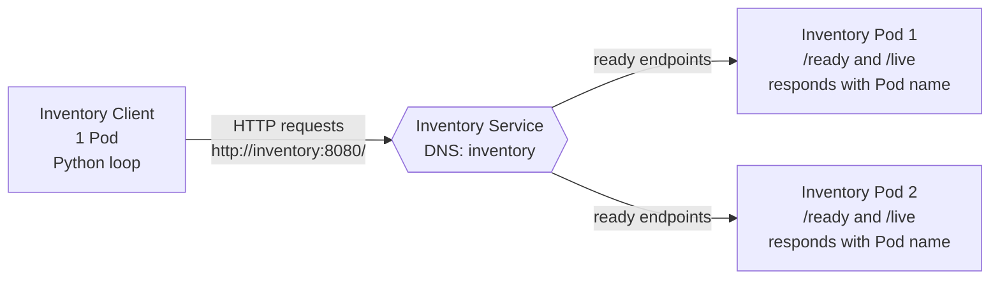
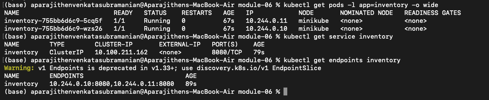
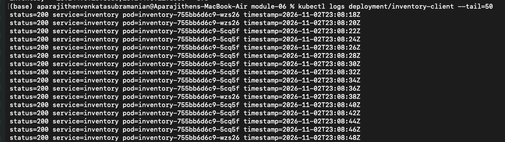
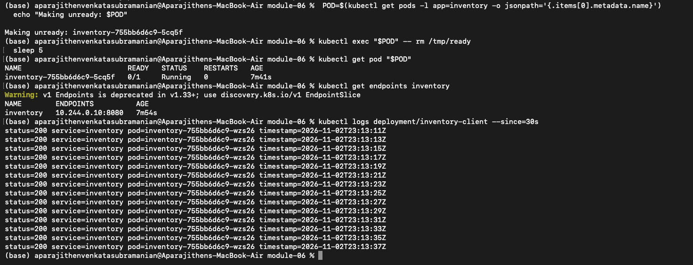
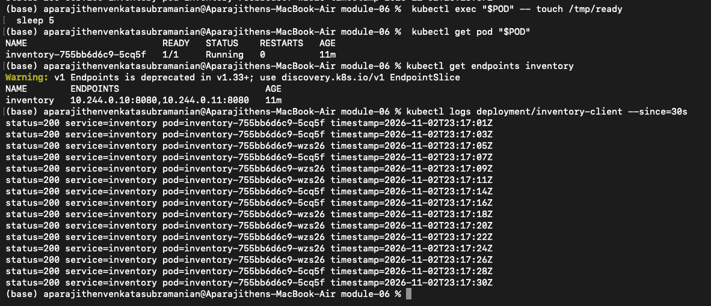
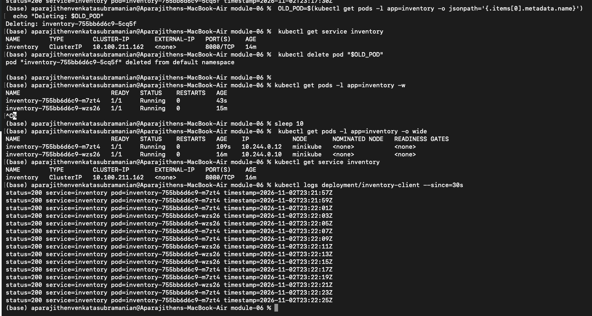

# Module 6: Service Discovery, Readiness & Recovery

This project deploys an Inventory service with two replicas and a continuously running client. The client calls the stable Kubernetes DNS name `inventory`, while each Inventory response includes the serving Pod name. Readiness is controlled by a file inside each Inventory container, which makes it possible to remove one replica from Service traffic without stopping its process.

## Architecture



The client resolves the Service name through Kubernetes DNS. The Service forwards traffic only to ready Inventory Pods, while the Deployment maintains two replicas. Each response includes the serving Pod name, making request distribution visible in the client log.

## Project files

- `app.py` provides `/`, `/ready`, and `/live`.
- `client.py` continuously requests the Inventory Service and prints the responding Pod name.
- `Dockerfile` builds one image used by both the Inventory and client containers.
- `k8s/inventory.yaml` defines the two-replica Inventory Deployment, the `inventory` ClusterIP Service, and the one-replica client Deployment.
- `scripts/build-minikube.sh` builds the image inside Minikube and deploys the manifests.

## Deployment

The deployment uses Minikube. With Minikube running and `kubectl` configured for it:

```bash
minikube start
./scripts/build-minikube.sh
```

The equivalent Docker Desktop Kubernetes image workflow is:

```bash
docker build -t cmpe273-inventory:1.0 .
kubectl apply -f k8s/inventory.yaml
kubectl rollout status deployment/inventory --timeout=120s
kubectl rollout status deployment/inventory-client --timeout=120s
```

The Service is intentionally named `inventory`, and the client environment variable is `http://inventory:8080/`. No Pod IP or Pod name is configured in the client.

## Verification and evidence record

The commands below are the reproducible evidence workflow. Terminal output and screenshots should be retained with the repository after the cluster run. The response fields are expected to contain real Pod names produced by that run; this repository does not invent names or logs.

The runtime evidence was collected from a Minikube cluster and is included below.

### Evidence 1: Both Inventory Pods running

```bash
kubectl get pods -l app=inventory -o wide
kubectl get service inventory
kubectl get endpoints inventory
```

This proves that the Deployment has two running replicas and that the Service selects both ready endpoints. Capture the terminal showing two `inventory-...` Pods with `READY 1/1`, the unchanged Service name `inventory`, and two endpoint addresses.

### Evidence 2: Both replicas receiving requests

```bash
kubectl logs deployment/inventory-client --tail=30
```

The client log contains lines such as `service=inventory pod=...`; the two different real Pod names demonstrate that Kubernetes load-balances requests through the Service. Capture enough lines to show both names and the initial `client target=http://inventory:8080/` line.

### Evidence 3: Readiness failure

```bash
POD=$(kubectl get pods -l app=inventory -o jsonpath='{.items[0].metadata.name}')
kubectl exec "$POD" -- rm /tmp/ready
kubectl get pod "$POD" -w
```

In a second terminal, while the watch is running:

```bash
kubectl get endpoints inventory -w
kubectl logs deployment/inventory-client --tail=20
```

The process remains running, but the selected Pod changes to `0/1` and disappears from the Service endpoints. The client continues receiving responses from the other ready Pod. Capture the Pod status, endpoint change, and client output.

### Evidence 4: Readiness recovery

```bash
kubectl exec "$POD" -- touch /tmp/ready
kubectl get pod "$POD"
kubectl get endpoints inventory
kubectl logs deployment/inventory-client --tail=30
```

After the next successful readiness probe, the Pod returns to `1/1` and its endpoint returns to the Service. The client log eventually shows that Pod name again. Capture the restored status, endpoint, and client response.

### Evidence 5: Pod deletion and replacement

```bash
OLD_POD=$(kubectl get pods -l app=inventory -o jsonpath='{.items[0].metadata.name}')
kubectl get service inventory
kubectl delete pod "$OLD_POD"
kubectl get pods -l app=inventory -w
```

After the replacement becomes ready:

```bash
kubectl get pods -l app=inventory -o wide
kubectl get service inventory
kubectl logs deployment/inventory-client --tail=30
```

This proves that the old Pod identity was replaced, the Deployment restored two replicas, the Service name remained `inventory`, and the client continued using the Service during recovery.

## Collected results

### Evidence 1: Both Inventory Pods running



The Deployment produced two ready Pods, `inventory-755bb6d6c9-5cq5f` and `inventory-755bb6d6c9-wz26`. The Service remained named `inventory`, had ClusterIP `10.100.211.162`, and exposed two ready endpoints, `10.244.0.10:8080` and `10.244.0.11:8080`.

### Evidence 2: Both replicas receiving requests



The client log showed HTTP 200 responses from both `inventory-755bb6d6c9-wz26` and `inventory-755bb6d6c9-5cq5f`. Each log line identified the destination as `service=inventory`, demonstrating Service-based discovery and traffic distribution across both replicas.

### Evidence 3: Readiness failure



Removing `/tmp/ready` from `inventory-755bb6d6c9-5cq5f` changed the Pod to `0/1` while its status remained `Running`. Its endpoint was removed from the Service, leaving `10.244.0.10:8080`; the client continued receiving HTTP 200 responses from `inventory-755bb6d6c9-wz26`.

### Evidence 4: Readiness recovery



Restoring `/tmp/ready` returned `inventory-755bb6d6c9-5cq5f` to `1/1`. Both endpoints were registered again, and subsequent client logs showed successful responses from both replica names.

### Evidence 5: Pod deletion and replacement



Deleting `inventory-755bb6d6c9-5cq5f` caused the Deployment to create `inventory-755bb6d6c9-m7zt4`, which had a new identity and IP address `10.244.0.12`. The surviving Pod was `inventory-755bb6d6c9-wz26`, the Service remained `inventory` with ClusterIP `10.100.211.162`, and the client continued receiving successful responses from the replacement and surviving Pods.

## Readiness and liveness behavior

`/ready` returns HTTP 200 only while `/tmp/ready` exists. The container lifecycle hook creates that file when a new Inventory container starts. Removing the file intentionally fails readiness while leaving the application process alive. Restoring the file makes the next readiness probe succeed. `/live` always reports the process as alive, so the readiness experiment does not cause a restart. The liveness probe checks `/live` every five seconds.

## Reflection

A stable Service name lets clients find the application through Kubernetes DNS without knowing which Pod is currently serving requests. Pods are temporary identities, so their names and IP addresses can change when a Pod is rescheduled or replaced. The Service keeps the client configuration unchanged while Kubernetes updates the set of healthy endpoints. This separation makes readiness checks and automatic recovery transparent to the client.
